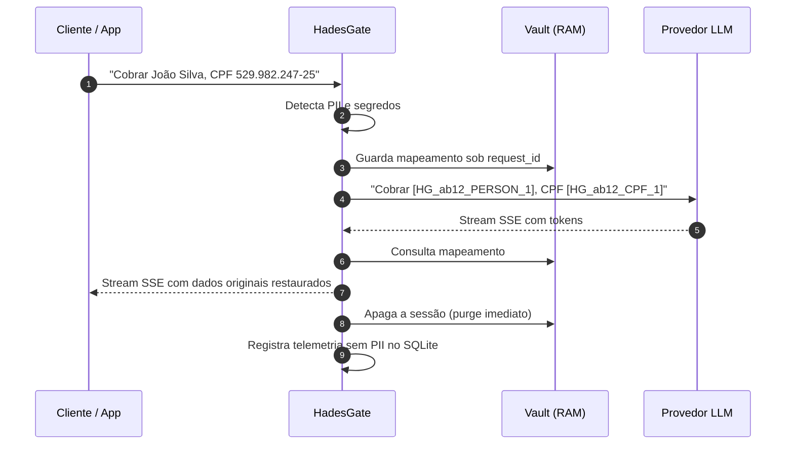

<div align="center">

<picture>
  <source media="(prefers-color-scheme: dark)" srcset="./docs/assets/hadesgate-logo-white.svg">
  <source media="(prefers-color-scheme: light)" srcset="./docs/assets/hadesgate-logo-purple.svg">
  
</picture>

# HADESGATE™

**AI Gateway em Go que anonimiza PII e segredos antes de chegarem ao LLM — e restaura tudo no streaming de volta.**

*Seus dados entram no submundo. Só os tokens saem.*

[](https://go.dev)
[](#-início-rápido)
[](#-arquitetura)
[](#-telemetria-zero-pii)
[](#-detectores)
[](./LICENSE)

[Como funciona](#-como-funciona) ·
[Início rápido](#-início-rápido) ·
[Detectores](#-detectores) ·
[Integrações](#-integrações) ·
[Configuração](#%EF%B8%8F-configuração) ·
[Apoie](#-apoie-o-hadesgate) ·
[Roadmap](./docs/ROADMAP.md)

</div>

---

<p align="center">
  
</p>

---

## 📌 O que é o HadesGate?

O **HadesGate** é um reverse proxy para APIs de LLM (OpenAI, Anthropic, Google Gemini, Ollama, Groq, vLLM, OmniRoute, LiteLLM…) que fica entre sua aplicação e o provedor de IA. Ele:

1. **Detecta** dados pessoais e segredos no prompt — CPF, CNPJ, PIX, cartões, IBAN, e-mails, telefones, nomes, API keys, JWTs, senhas, chaves privadas.
2. **Substitui** cada um por um token opaco e isolado por requisição, como `[HG_7bd675b17a1e_CPF_1]`.
3. **Encaminha** o prompt já sanitizado ao provedor. **O LLM nunca vê o dado real.**
4. **Restaura** os valores originais na resposta, inclusive em **streaming SSE**, token a token.
5. **Esquece** tudo: o mapeamento vive só na RAM e é apagado no fim da resposta.

Tudo isso num **binário Go estático**, sem Python, sem modelo de NLP pesado e sem dependências de runtime.

```diff
- Envie um e-mail para João da Silva, CPF 529.982.247-25, no contato joao.silva@empresa.com.br
+ Envie um e-mail para [[PERSON_1]], CPF [[CPF_1]], no contato [[EMAIL_1]]
```

---

## ✨ Destaques

| | |
|---|---|
| ⚡ **Overhead sub-milissegundo** | Detecção determinística (regex + checksums), sem inferência de modelo no caminho crítico. |
| 🔄 **Streaming de verdade** | Detokenizador com janela deslizante reconstrói tokens quebrados entre chunks SSE (`[HG_..._PER` + `SON_1]`). |
| 🧮 **Validação matemática** | Módulo 11 (CPF, CNPJ, CNH), Luhn (cartões), ISO 13616 Mod-97 (IBAN). Menos falso positivo. |
| 🔐 **Tokens imprevisíveis** | Namespace aleatório (`crypto/rand`) por requisição — impossível correlacionar conversas. |
| 🧠 **Deduplicação canônica** | `529.982.247-25` e `52998224725` viram o **mesmo** token, preservando o raciocínio do LLM. |
| 🗄️ **Telemetria Zero-PII** | SQLite em Go puro guarda só métricas e o prompt já mascarado. Nunca o dado real. |
| 🎛️ **Políticas por entidade** | `mask`, `contextual`, `block`, `route_local` ou `disabled` por tipo de dado e por tenant. |
| 🩺 **Saúde contextual** | Medicamentos e CIDs só são protegidos quando ligados a uma identidade no mesmo trecho; consultas clínicas genéricas continuam úteis. |
| 🖥️ **Dashboard embutido** | Console em estilo *Industrial Brutalism*, dark mode padrão, PT-BR/EN, servido pelo próprio binário. |

---

## 🧭 Como funciona



### Ciclo de vida de um token

| Etapa | Onde vive o dado real | O que o provedor vê |
|---|---|---|
| Requisição chega | Memória do processo | — |
| Anonimização | Vault em RAM, indexado pelo `request_id` | `[HG_<ns>_CPF_1]` |
| Resposta em streaming | Vault em RAM | — |
| Fim da resposta | **Apagado** | — |
| Telemetria (SQLite) | **Nunca gravado** | — |

> [!NOTE]
> O namespace muda a cada requisição. O mesmo CPF enviado duas vezes, em chamadas diferentes, gera tokens diferentes. Dentro da **mesma** requisição, o mesmo valor sempre recebe o mesmo token.

---

## 🚀 Início rápido

### Docker Compose (recomendado)

```bash
git clone https://github.com/<seu-usuario>/hadesgate.git
cd hadesgate
cp .env.example .env        # defina HADESGATE_ADMIN_KEY, HADESGATE_CONFIG_MASTER_KEY e provedores
docker compose up -d --build
```

### Docker CLI

```bash
docker build -t hadesgate:latest .
# Gere uma vez, guarde em um cofre e reutilize nas recriações do container.
export HADESGATE_CONFIG_MASTER_KEY="$(openssl rand -base64 32)"
docker run -d --name hadesgate -p 8080:8080 \
  -v hadesgate_data:/app/data \
  -e HADESGATE_BIND_ADDRESS=0.0.0.0 \
  -e HADESGATE_ADMIN_KEY=troque_esta_chave \
  -e HADESGATE_CONFIG_MASTER_KEY \
  -e ANTHROPIC_API_KEY=sk-ant-... \
  hadesgate:latest
```

### A partir do código-fonte

```bash
# Requer Go 1.27.4+ e Node 20+
cd frontend && npm install && npm run build && cd ..
# copie frontend/out para internal/web/dist (veja o Makefile)
CGO_ENABLED=0 go build -o hadesgate ./cmd/hadesgate
./hadesgate
```

Depois de subir:

| Recurso | URL |
|---|---|
| Dashboard | http://localhost:8080 |
| OpenAI-compatible | `http://localhost:8080/v1/chat/completions` |
| Anthropic Messages | `http://localhost:8080/v1/messages` |
| Google Gemini API | `http://localhost:8080/v1beta/models/{model}:generateContent` |
| Healthcheck | `http://localhost:8080/api/status` |

---

## 🛡️ Detectores

### Dados pessoais (LGPD e internacionais)

| Entidade | Tipo | Validação |
|---|---|---|
| CPF | `CPF` | Módulo 11 (Receita Federal) + contexto |
| CNPJ | `CNPJ` | Módulo 11 com pesos oficiais |
| CNH | `CNH` | Módulo 11 (CONTRAN) + desambiguação com CPF |
| RG | `RG` | Formato + contexto obrigatório |
| Passaporte BR | `PASSPORT` | Padrão Polícia Federal + contexto |
| Chave PIX | `PIX` | EVP (UUID), CPF, CNPJ, e-mail e telefone em contexto PIX |
| Agência / Conta | `BANK_ACCOUNT` | Contexto bancário (Itaú, Bradesco, Nubank, Inter…) |
| IBAN | `IBAN` | ISO 13616 Mod-97 |
| Cartão de crédito | `CREDIT_CARD` | Luhn + bandeira |
| Telefone | `PHONE` | DDDs brasileiros + E.164 internacional |
| E-mail | `EMAIL` | RFC 5322 |
| CEP | `CEP` | Formato dos Correios + contexto |
| Endereço IP | `IP_ADDRESS` | IPv4 / IPv6, ignorando números de versão |
| Nome próprio | `PERSON` | Contexto + catálogo de nomes/sobrenomes; aceita caixa livre e até oito partes substantivas |
| US SSN | `SSN` | Validação SSA (regras de área, grupo, serial e dummies) |
| US EIN | `EIN` | Validação de prefixos de campus IRS |
| UK NINO | `NINO` | Regras oficiais HMRC (prefixos, caracteres proibidos e sufixo) |
| UK NHS | `NHS` | Módulo 11 oficial da National Health Service |
| DNI / NIE Espanhol | `DNI` | Algoritmo Módulo 23 com tabela oficial de caracteres de controle |
| NIR Francês | `NIR` | Módulo 97 do INSEE (Sécurité Sociale / Carte Vitale) |
| Codice Fiscale Italiano | `CODICE_FISCALE` | Algoritmo alfanumérico com tabela de paridade da Agenzia delle Entrate |
| HIPAA Medical Suite | `MEDICAL_ID` | NPI (Luhn 80840), DEA (checksum prescritores) e Prontuários (MRN) |
| Cartão SUS / CNS | `SUS_CARD` | Módulo 11 oficial do Ministério da Saúde / DATASUS |
| CID-10 & CID-11 | `CID` | Classificação Internacional de Doenças e códigos diagnósticos |
| Medicamentos (Catálogo ANVISA) | `MEDICATION` | 24.000+ fármacos e princípios ativos via autômato Aho-Corasick em Go, com sync em streaming |
| Veículos & Transporte | `VEHICLE` | Placas Mercosul/Cinza, RENAVAM (Módulo 11) e Chassi (ISO 3779) |
| Dispositivos de Rede & Hardware | `DEVICE_ID` | IMEI celular (Luhn + contexto) e Endereço MAC (IEEE 802) |
| Processo Judicial CNJ | `LEGAL` | Módulo 97 da Resolução 65 do CNJ e termos sob sigilo |
| Identificadores Cidadãos | `GOVERNMENT_ID` | Título de Eleitor (Módulo 11 TSE) e PIS/PASEP/NIT (Módulo 11) |
| Dados Corporativos | `CORPORATE` | Balanços confidenciais, faturamento e contratos empresariais |

### Segredos e credenciais

| Entidade | Exemplos |
|---|---|
| `API_KEY` | OpenAI, Anthropic, Google / Gemini, AWS, GitHub, GitLab, Slack, Stripe, Groq, xAI, NPM, PyPI, SendGrid |
| `SECRET` | `Bearer` tokens, JWT, senhas em contexto (`password=…`), connection strings (`postgres://user:pass@…`), chaves privadas PEM/OpenSSH |

Também é possível definir **allowlist**, **denylist** e regras customizadas, além de um detector semântico **opcional** via sidecar local (desligado por padrão — o núcleo funciona 100% sem ele).

---

## 🔌 Integrações

O HadesGate é *drop-in*: cadastre uma vez a chave BYOK no tenant pelo Console e
depois troque apenas a `base_url`. O gateway persiste somente um fingerprint
HMAC-SHA256 da chave; o SDK continua enviando a credencial original no header
nativo e ela é encaminhada ao provedor.

<details open>
<summary><b>Python — OpenAI SDK</b></summary>

```python
import os
from openai import OpenAI

client = OpenAI(base_url="http://localhost:8080/v1", api_key=os.environ["OPENAI_API_KEY"])

stream = client.chat.completions.create(
    model="gpt-4o-mini",
    messages=[{"role": "user", "content": "Cobrar Mariana Alves, CPF 529.982.247-25"}],
    stream=True,
)
for chunk in stream:
    print(chunk.choices[0].delta.content or "", end="", flush=True)
```
</details>

<details>
<summary><b>Python — Anthropic SDK</b></summary>

```python
import os
import anthropic

client = anthropic.Anthropic(base_url="http://localhost:8080", api_key=os.environ["ANTHROPIC_API_KEY"])

msg = client.messages.create(
    model="claude-sonnet-4-6",
    max_tokens=512,
    messages=[{"role": "user", "content": "Responda a joao.silva@empresa.com.br sobre a fatura"}],
)
print(msg.content[0].text)
```
</details>

<details>
<summary><b>Python — Google Gemini SDK</b></summary>

```python
import os
from google import genai
from google.genai import types

client = genai.Client(
    api_key=os.environ["GEMINI_API_KEY"],
    http_options=types.HttpOptions(base_url="http://localhost:8080"),
)

for chunk in client.models.generate_content_stream(
    model="gemini-2.5-flash",
    contents="Cobrar Mariana Alves, CPF 529.982.247-25",
):
    print(chunk.text or "", end="", flush=True)
```
</details>

<details>
<summary><b>Node.js / TypeScript</b></summary>

```typescript
import OpenAI from "openai";

const client = new OpenAI({
  baseURL: "http://localhost:8080/v1",
  apiKey: process.env.OPENAI_API_KEY,
});

const stream = await client.chat.completions.create({
  model: "gpt-4o-mini",
  messages: [{ role: "user", content: "Atualize o cadastro de Carlos Souza, CPF 111.444.777-35" }],
  stream: true,
});
for await (const chunk of stream) process.stdout.write(chunk.choices[0]?.delta?.content ?? "");
```
</details>

<details>
<summary><b>cURL</b></summary>

```bash
curl http://localhost:8080/v1/messages \
  -H "Authorization: Bearer $ANTHROPIC_API_KEY" \
  -H "Content-Type: application/json" \
  -d '{
    "model": "claude-sonnet-4-6",
    "max_tokens": 256,
    "messages": [{"role": "user", "content": "Enviar recibo para João Silva, CPF 529.982.247-25"}]
  }'
```
</details>

### Endpoints suportados

| Protocolo | Rota |
|---|---|
| OpenAI Chat Completions | `/v1/chat/completions` (inclui roteamento `gemini-*`) |
| OpenAI Responses | `/v1/responses` |
| Anthropic Messages | `/v1/messages`, `/anthropic/v1/messages` |
| Google Gemini Native | `/v1beta/models/{model}:generateContent`, `:streamGenerateContent?alt=sse` |
| Lista de modelos | `/v1/models` |

Suporta conteúdo multimodal, *tool calls* (streaming e não-streaming) e preserva todos os campos SSE originais.

**IDEs e agentes:** Cursor, Claude Code, Cline e qualquer cliente compatível com OpenAI/Anthropic.
**AI routers:** OmniRoute, 9Router, LiteLLM — veja o [guia de integração com routers](./docs/ROUTER_INTEGRATIONS.md).

---

## 📊 Telemetria Zero-PII

O dashboard embutido mostra, de forma objetiva, **o que foi protegido**:

- **REQUISIÇÕES** — total interceptado
- **MASCARADOS** — % de requisições com dados protegidos e quantidade de itens assegurados
- **TEMPO DE SCAN** — latência média da anonimização
- **TAXA** — requisições por hora
- Tabela paginada com **provedor/modelo**, **idioma**, **PII detectado**, **segredos** e o **prompt mascarado** expansível

> [!IMPORTANT]
> O SQLite (`modernc.org/sqlite`, Go puro) armazena **apenas** métricas, categorias de entidades e o prompt **já sanitizado**. Valores originais e o mapa de tokens **nunca** tocam o disco.

A retenção pode ser configurada globalmente ou por tenant por quantidade de dias e máximo de registros. A política específica do tenant prevalece sobre `*`, permitindo expiração e quotas sem misturar dados entre departamentos.

---

## ⚙️ Configuração

Todas as opções via variáveis de ambiente (veja [`.env.example`](./.env.example)).

| Variável | Padrão | Descrição |
|---|---|---|
| `HADESGATE_BIND_ADDRESS` | `127.0.0.1` | Interface HTTP; use `0.0.0.0` somente em container/rede protegida |
| `PORT` | `8080` | Porta HTTP |
| `HADESGATE_ADMIN_KEY` | *gerada* | Chave do dashboard e da API |
| `HADESGATE_PROXY_KEY` | *gerada separadamente* | Chave opcional para clientes gerenciados; nunca concede acesso administrativo |
| `HADESGATE_FINGERPRINT_SECRET` | — | Segredo HMAC estável para identificar chaves BYOK sem persistir o valor original |
| `HADESGATE_CONFIG_MASTER_KEY` | **obrigatória** | Chave externa de 32 bytes (base64/hex) para AES-256-GCM dos segredos no SQLite |
| `HADESGATE_ALLOW_LEGACY_URL_KEYS` | `false` | Reativa temporariamente `/p/{key}` e `/t/{proxy_key}` durante migrações |
| `HADESGATE_CORS_ALLOWED_ORIGINS` | — | Origens cross-origin confiáveis; vazio nega CORS por padrão |
| `HADESGATE_ENABLE_EGRESS_SCAN` | `false` | Mascara novos dados sensíveis em respostas JSON e streams SSE |
| `OPENAI_BASE_URL` | `https://api.openai.com/v1` | Upstream OpenAI-compatible |
| `OPENAI_API_KEY` | — | Chave do upstream OpenAI |
| `ANTHROPIC_BASE_URL` | `https://api.anthropic.com` | Upstream Anthropic |
| `ANTHROPIC_API_KEY` | — | Chave do upstream Anthropic |
| `GEMINI_BASE_URL` | `https://generativelanguage.googleapis.com` | Upstream Google Gemini |
| `GEMINI_API_KEY` | — | Chave do upstream Google Gemini (ou `GOOGLE_API_KEY`) |
| `OLLAMA_BASE_URL` | `http://host.docker.internal:11434/v1` | Endpoint local (também usado por `route_local`) |
| `HADESGATE_ENTITY_ACTIONS` | `mask` | Ex.: `CREDIT_CARD:block,MEDICATION:contextual,VEHICLE:disabled` |
| `HADESGATE_TENANT_ENTITY_ACTIONS` | — | Overrides por tenant; ex.: `analytics|VEHICLE:disabled;financeiro|CPF:block` |
| `HADESGATE_TENANT_PROXY_KEYS` | — | Chaves por tenant (`tenant:chave`) |
| `HADESGATE_ALLOW_DYNAMIC_UPSTREAM` | `false` | Habilita o header `X-Upstream-Url` |
| `HADESGATE_DYNAMIC_UPSTREAM_ALLOWED_HOSTS` | — | Allowlist exata `host:porta` |
| `HADESGATE_ALLOW_PRIVATE_DYNAMIC_UPSTREAM` | `false` | Permite que entradas dinâmicas já allowlisted resolvam para loopback/RFC1918 |
| `HADESGATE_PRIVATE_UPSTREAM_ALLOWED_HOSTS` | — | Autoriza hosts privados configurados, preferencialmente com porta exata |
| `HADESGATE_MAX_CONCURRENT_REQUESTS` | `128` | Limite de concorrência (excedente → 429) |
| `VAULT_TTL` | `10m` | TTL de segurança do vault em RAM |
| `HADESGATE_DB_PATH` | `./data/hadesgate.db` | Arquivo SQLite da telemetria |
| `TRACE_BUFFER_SIZE` | `1000` | Máximo de registros mantidos |
| `SEMANTIC_DETECTOR_ENABLED` | `false` | Sidecar semântico opcional |

> Variáveis legadas `PRIVAGATE_*` continuam aceitas como fallback.

> [!NOTE]
> A ação `contextual` é segura por padrão apenas para `MEDICATION` e `CID`. Termos isolados, como “Amoxicilina 500 mg” ou “CID J45.0”, podem seguir ao modelo; quando aparecem no mesmo trecho de uma identidade direta (nome, CPF, e-mail, telefone, SUS ou prontuário), ambos permanecem no fluxo normal de mascaramento. `SUS_CARD` e `MEDICAL_ID` continuam em `mask`. O limiar de confiança mede a certeza da detecção e não substitui essa análise de relacionamento. Regras explícitas `mask`, `block`, `route_local` e `disabled`, inclusive por tenant, prevalecem sobre o padrão contextual.

> [!CAUTION]
> A ação `disabled` desliga o DLP para a entidade ou macro-família selecionada: o valor não é detectado, tokenizado, contabilizado nem bloqueado e pode seguir em texto puro ao provedor. Use somente quando esse comportamento for intencional. Uma regra específica do tenant pode sobrescrever a global; `inherit` mantém a regra global. Para preservar o Zero-PII, a telemetria não persiste o prompt sanitizado enquanto a política efetiva tiver qualquer ação `disabled`.

> [!IMPORTANT]
> `HADESGATE_CONFIG_MASTER_KEY` nunca é persistida no SQLite. Na primeira inicialização com a chave, segredos legados em plaintext são migrados para envelopes `enc:v1` AES-256-GCM. Faça backup seguro da chave: uma chave diferente ou ciphertext adulterado faz o armazenamento falhar de forma segura. As APIs e o Console tratam chaves de proxy, URL e segredo de webhook como write-only; valores atuais nunca são devolvidos.

Upstreams dinâmicos passam por resolução DNS/IP em cada nova conexão e o socket é aberto diretamente no IP validado, evitando DNS rebinding. Endereços link-local, metadata, multicast, não especificados e faixas reservadas permanecem bloqueados mesmo com opt-in para redes privadas. Redirecionamentos HTTP de upstream são rejeitados.

### Escopo das credenciais

| Credencial | Escopo permitido |
|---|---|
| `HADESGATE_ADMIN_KEY` | Login do Console, Playground, traces, vault e APIs administrativas `/api/*` |
| Credencial administrativa `viewer` | Consulta configurações públicas, retenção, traces sanitizados e auditoria assinada |
| Credencial administrativa `operator` | Tudo de `viewer`, mais políticas, tenants, retenção, credenciais BYOK e operações do gateway |
| Credencial administrativa `admin` | Tudo de `operator`, mais criação/revogação de credenciais administrativas e backup/restauração |
| `HADESGATE_PROXY_KEY` | Requisições aos endpoints de IA; não autentica o Console |
| Chave de proxy do tenant | Requisições de IA identificadas pelo tenant; não autentica o Console |
| Chave BYOK do provedor | Proxy transparente após cadastro do fingerprint; não autentica o Console |

O endpoint `/api/auth/verify` valida exclusivamente credenciais administrativas e informa `key_id`/papel. Não existem contas de usuário: chaves rotacionáveis são armazenadas somente como fingerprint HMAC e o segredo é exibido uma única vez. `HADESGATE_ADMIN_KEY` permanece como credencial `admin` de bootstrap/recuperação. Sessões salvas no navegador são revalidadas no servidor a cada carregamento; um valor manipulado no `sessionStorage` não concede acesso às APIs.

### Governança e recuperação

| Endpoint | Papel mínimo | Finalidade |
|---|---|---|
| `/api/admin-credentials` | `admin` | Criar, listar e revogar chaves administrativas sem usuários |
| `/api/retention` | `viewer` leitura / `operator` escrita | Retenção temporal e quota de registros global/tenant |
| `/api/audit/events` | `viewer` | Exportar eventos Zero-PII com nonce único e assinatura HMAC-SHA256 |
| `/api/config-backup` | `admin` | Exportar/restaurar envelope AES-256-GCM sem vault, traces ou plaintext |

Alterações de políticas, tenants, credenciais, retenção, telemetria e backups registram somente metadados operacionais, `actor_key_id`, papel e timestamp. O arquivo de backup depende da mesma `HADESGATE_CONFIG_MASTER_KEY`; guarde ambos separadamente.

---

## 🏗️ Arquitetura

```
hadesgate/
├── cmd/
│   ├── hadesgate/          # Entrypoint do gateway
│   └── pii-benchmark/      # Gate de precisão/recall dos detectores
├── internal/
│   ├── anonymizer/         # Motor de anonimização e tokens [HG_...]
│   │   ├── detector/       # CPF, CNPJ, PIX, IBAN, API keys, segredos...
│   │   └── vault/          # Vault efêmero em memória
│   ├── stream/             # Detokenizador SSE com janela deslizante
│   ├── protocol/           # Extratores OpenAI / Responses / Anthropic
│   ├── proxy/              # Gateway, upstreams, auth e limites
│   ├── policy/             # Ações mask / contextual / block / route_local / disabled
│   ├── observability/      # Telemetria SQLite Zero-PII
│   ├── config/             # Variáveis de ambiente
│   └── web/                # API do dashboard + frontend embutido
├── frontend/               # Next.js (export estático)
├── benchmarks/             # Corpus de acurácia PT-BR
└── docs/                   # Roadmap, integrações e assets
```

**Princípios de design**

- **Leve por padrão** — um binário, processamento em memória.
- **Caminho rápido determinístico** — sem inferência no caminho crítico.
- **Privacidade por padrão** — mapeamentos voláteis e por requisição.
- **IA local opcional** — o sidecar semântico nunca é obrigatório.
- **Degradação segura** — se algo opcional falhar, a proteção determinística continua.

---

## 🧪 Testes e qualidade

```bash
make dev       # sobe Go (air) + Next.js em hot reload
make quality   # roda go vet, testes unitários, gate de acurácia PII e tsc
make bench     # microbenchmarks de latência e alocações do motor
```

O CI ([`.github/workflows/ci.yml`](./.github/workflows/ci.yml)) valida um corpus determinístico com **135 cenários** (80 positivos, 55 controles negativos e 30 tipos de entidade). O gate exige precisão e recall `≥ 90%` tanto no agregado quanto em **cada tipo**, além de validar a estrutura mínima do corpus e o typecheck estático do painel. Testes metamórficos exercitam mudanças de contexto/formato e o detokenizador é validado em todos os pontos de fragmentação do stream.

---

## 🗺️ Roadmap

Veja o [ROADMAP completo](./docs/ROADMAP.md). Próximos passos incluem governança, retenção, resiliência operacional e expansão contínua dos cenários adversariais do corpus.

---

## 💜 Apoie o HadesGate

Se o HadesGate ajuda seu projeto, você pode apoiar o desenvolvimento via PIX.

<p align="center">
  
</p>

**Chave PIX (UUID) — clique no ícone de copiar do bloco:**

```text
276bec8f-d79f-48a2-813e-79218df9bce2
```

<details>
<summary><strong>PIX Copia e Cola</strong></summary>

```text
00020101021126580014br.gov.bcb.pix0136276bec8f-d79f-48a2-813e-79218df9bce25204000053039865802BR5920RODOLFO D C BANDEIRA6011PEDRO VELHO62070503***6304AE0A
```

</details>

Antes de confirmar, confira no aplicativo do banco o recebedor **RODOLFO D C BANDEIRA**.

---

## 🤝 Contribuindo

Contribuições da comunidade (humanas ou assistidas por agentes de IA) são bem-vindas!

- Leia o guia completo de ambiente local, hot reload (`make dev`) e criação de detectores em [**`CONTRIBUTING.md`**](./CONTRIBUTING.md).
- Vai usar **Claude Code, Cursor, Antigravity, Codex ou Copilot**? O repositório já traz regras e travas automáticas configuradas em [**`AGENTS.md`**](./AGENTS.md), [**`frontend/AGENTS.md`**](./frontend/AGENTS.md) e [`.claude/`](./.claude).

Ao adicionar um detector, inclua casos **positivos e negativos** em [`benchmarks/pii-accuracy/corpus.json`](./benchmarks/pii-accuracy/corpus.json) e rode `make quality`.

---

## 🔒 Segurança

Encontrou uma vulnerabilidade? **Não abra uma issue pública.** Entre em contato com os mantenedores de forma privada para que o problema seja corrigido antes da divulgação.

> [!WARNING]
> O HadesGate reduz drasticamente a exposição de dados sensíveis, mas nenhuma detecção automática é infalível. Use-o como uma camada de defesa dentro da sua estratégia de conformidade com a LGPD, não como a única.

---

## 📄 Licença

Copyright © 2026 Rodolfo Bandeira e contribuidores do HadesGate.

O HadesGate é software livre licenciado sob a **GNU Affero General Public License v3.0 somente** (`AGPL-3.0-only`). Consulte o texto integral em [`LICENSE`](./LICENSE).

Você pode usar, estudar, modificar, executar e redistribuir o HadesGate, inclusive comercialmente. Se distribuir uma versão modificada ou disponibilizá-la para usuários por uma rede, deverá cumprir a AGPL, incluindo oferecer o código-fonte correspondente dessa versão sob a mesma licença. A AGPL permite forks e revenda; sua proteção é o *copyleft* forte, não uma proibição de concorrência ou de uso comercial.

> A alteração de MIT para AGPL-3.0-only vale para as versões licenciadas desta forma e não recolhe direitos de cópias que tenham sido obtidas legitimamente sob a licença MIT anterior. Para interpretação aplicável ao seu caso, consulte assessoria jurídica.

---

<div align="center">

Feito em Go com 💜 para quem leva privacidade a sério.

**[⬆ Voltar ao topo](#hadesgate)**

</div>
